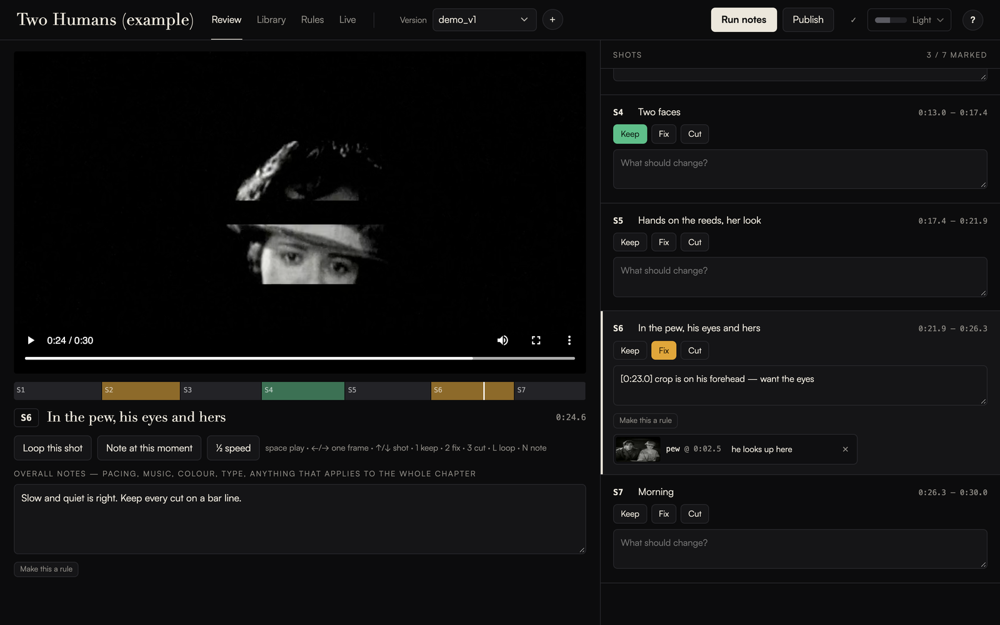
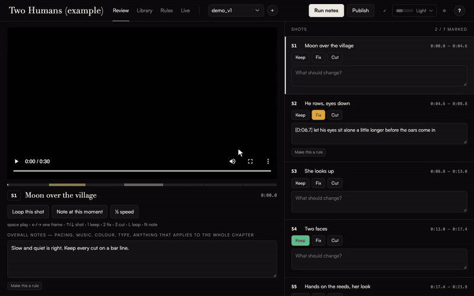
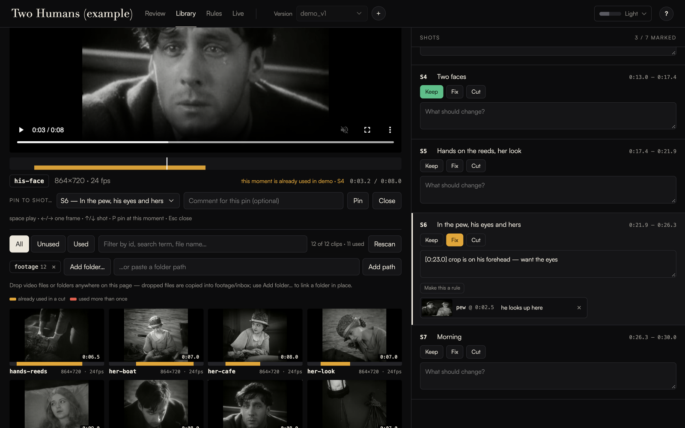
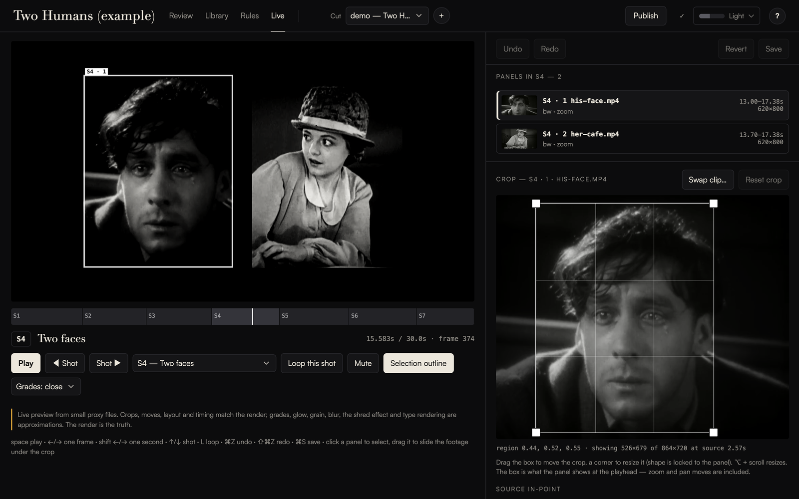
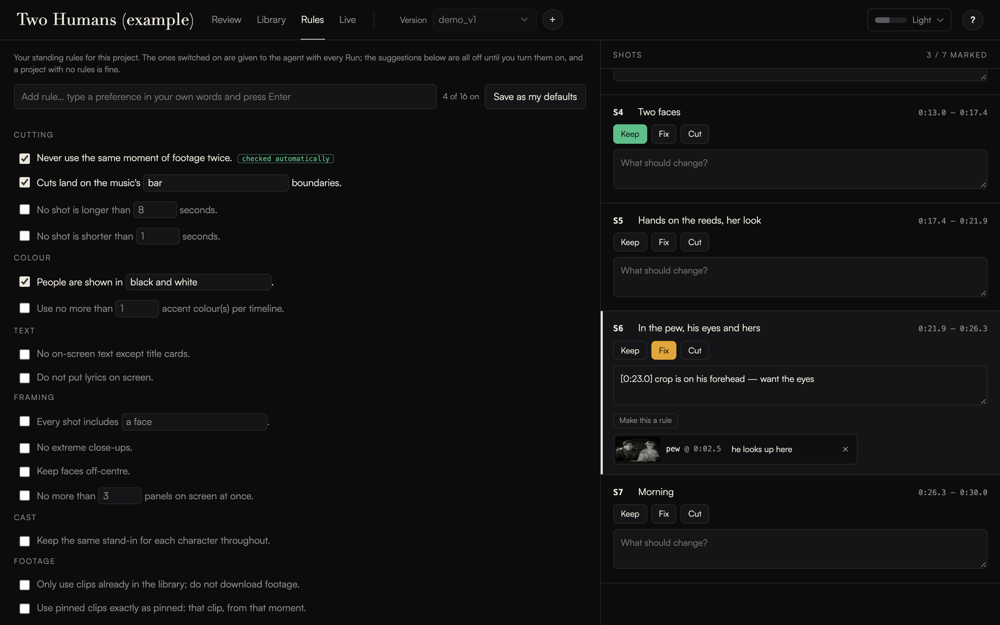
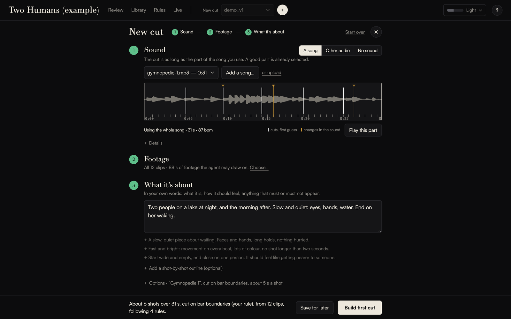

# cutvelvet

Notes in, new cut out. A local tool for cutting short, music-driven films from footage you already
have, where a coding agent does the editing and you give the notes.

> Status: early. It was built while cutting one film and has been used by one person.



## What it is

You watch a version, write notes on the shots ("this crop is on her nose, I want the eyes", "find
something where she smiles", "this drags"), and press Run. An agent you already have installed
edits the cut, checks its own frames, renders, and hands back the next version with a line per note
saying what it did. For anything you would rather do by hand, a live preview lets you drag a crop
or swap a clip and see it instantly, without rendering.

## What it is not

It is not a cheaper Premiere, Resolve or CapCut. Those do everything a general editor does and this
does not try to. There is no multi-track audio mixing, no dialogue editing, no colour suite, no
generated footage. It makes one kind of film: a montage of cropped strips of existing footage, cut
to a song.

## Why use it

- **You direct instead of operate.** No timeline to drive. Watch, say what is wrong, get a new cut.
- **The agent finds the footage.** Searching, scrubbing and placing clips is the slow part of an
  archive or stock edit. The library shows what you have and what is already used.
- **The cut is a text file.** One JSON file per timeline. Every published version is snapshotted,
  so versions are reproducible, comparable and undoable, and any agent can read and change them.
- **Your rules persist.** "Never reuse a moment of footage", "people in black and white": tick a
  preset or type your own, and they are given to the agent on every run. The tool has no house
  style of its own.
- **Local, with your own model.** Nothing is uploaded. No account. It runs whichever command-line
  agent you configure (Claude Code by default).

## What it costs to run

The tool is free. The agent is not: each Run is billed by your agent's provider to your own
account. Rendering uses your CPU; the page shows how hard, and a Performance setting
(Light / Balanced / Fast) controls it.

## Requirements

- Python 3.9 or newer (the only two packages it needs, `numpy` and `pillow`, install with it)
- `ffmpeg` and `ffprobe` on your PATH (on Apple Silicon, use native arm64 builds of Python and ffmpeg)
- A recent Chrome for the page (other browsers are untested)
- For the agent features (Run notes, New cut): a command-line coding agent that can read images and
  edit files, already installed and signed in on your machine. Everything else works without one.

There is no Node, npm or build step.

## Install and start

```
git clone https://github.com/Zach-Self/cutvelvet
cd cutvelvet
python3 -m venv .venv && source .venv/bin/activate
pip install .
cutvelvet new ~/my-film                 # makes the folders; put clips in footage/ (a song in music/ is optional)
cutvelvet serve ~/my-film               # then open http://127.0.0.1:8771
```

A project is a folder with a `project.json`, a `timelines/` folder, and your footage and music.
A new project opens on a short checklist: add footage, optionally a song, choose your agent, make
the first cut.
In the page, **+ New cut** takes a song (optional), your footage and a few lines of intent, and has
your agent build the first draft. The layout and the cut's file format are described in
[AGENTS.md](AGENTS.md).

## Try the example

The repository includes a small project: twelve clips from a 1927 public-domain film (*Sunrise*),
half a minute of Satie, and a 30-second cut with review notes waiting on it
([credits](example/CREDITS.md)).

```
cutvelvet serve example                 # then open http://127.0.0.1:8771
```

Shot S6 has a note that its crop is on his forehead. Fix it in Live (drag the crop box, Save,
Publish), or press Run notes and let your agent do it. See [example/README.md](example/README.md).



| | |
|---|---|
|  |  |
|  |  |

## Which model does it use?

cutvelvet does not talk to a model itself and never sees an API key. When you press Run notes or
Build first cut, it starts the command-line agent you already use (Claude Code by default) on your
machine, hands it the notes, and lets it work in the project folder with a short list of permitted
tools. Your agent's provider bills you for each run.

To choose, open **Settings** (the gauge in the header) and look under **Agent**:

- cutvelvet lists the agents it knows (Claude Code, Codex CLI, Gemini CLI) and which are installed.
  If you choose nothing it uses the first one it finds. "Custom command" takes any other agent.
- Only Claude Code has been tested. The others are starting templates marked "untested".
- **Model** is optional: leave it empty for the agent's own default, or type a model name it accepts.
- The exact command that will run is shown and can be edited.
- **Test** sends one tiny prompt to confirm the agent starts and is signed in. It is a real, billed
  call (about 30 cents with Claude Code when we tried it).

These settings are saved on your computer in `~/.cutvelvet/settings.json`, not in the project. If a
project folder you open asks for its own agent command, cutvelvet shows it and does not use it unless
you allow it.

## The page

Everything is one page; switching tabs never reloads it, and each tab keeps where you were.

| Tab | What it is for |
|---|---|
| Review | Watch a version, mark shots, write timestamped notes, pin clips to notes. **Run notes** (in the header) hands them to the agent. |
| Library | Every clip in your footage folders, with hover-scrub and a bar showing which seconds are already in a cut. Add a folder, or drop files in. |
| Live | Plays the cut in the browser with no render. Drag crops, change in-points, grade, swap clips, save. Framing is exact; colour is approximate. |
| Rules | Standing preferences: neutral presets (all off by default) plus your own. |
| + New cut | Start a cut from a song, footage and a brief. |

In the header: **Publish version** (on Review and Live) renders the cut as it is saved now and adds it
to Review as the next version, with no agent involved; a chip shows any job that is running, on every
tab; and the meter shows how busy the machine is and holds the Performance setting.

## Commands

```
cutvelvet serve   <project>               the page
cutvelvet audit   <project> [timeline]    validate, report repeated footage
cutvelvet stills  <project> <timeline> 12.5,40    single frames, in seconds
cutvelvet render  <project> <timeline> --scale 0.5
cutvelvet publish <project> <timeline> --scale 0.5    render and add the next review version
cutvelvet new     <dir> [--name "My film"]           start a project folder
cutvelvet analyze <project> <audio>                  analyse a song for cutting
```

## For agents

[AGENTS.md](AGENTS.md) is the complete guide: setup, project layout, timeline schema, commands,
the review loop, and how to place a crop reliably. An agent that reads it can operate the tool.

## Footage and music

cutvelvet ships none beyond the small public-domain example (see `example/CREDITS.md`). What you cut with, and whether you may publish it, is your responsibility.

## Design limits, on purpose

- Runs on your machine only; the server listens on 127.0.0.1 and has no accounts.
- What it trusts, what it does not, and the risks that stay yours: [SECURITY.md](SECURITY.md).
- Two Python dependencies, a standard-library server, a page with no build step.
- Direct manipulation is limited to crop, in-point, grade, speed and swapping a clip. Everything
  else is a note.

## Not there yet

- New cut has made first cuts with a real agent only on a five-clip test project; a full library is unproven
- Run notes has not yet been run end to end with a real agent on real notes
- Export to an edit list that Resolve or Premiere can open
- Testing outside macOS and Chrome
